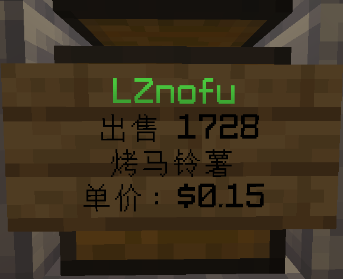
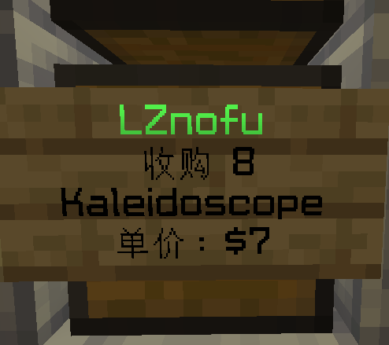
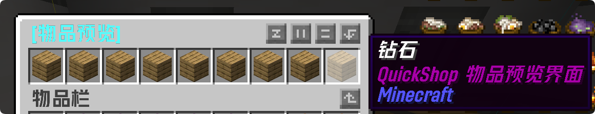

# 商店插件

本服务器使用QuickShop插件，如何使用请看下文：

## 认识商店

### 商店由什么组成?

商店一般由箱子（单格）组成，上面常挂着告示牌，内容如下：

（收购）

**[玩家名]**或者系统商店

** 收购　[数量]**通常为1~1728，系统商店为无限，或空间不足

**[物品名称]**

**单价 ：$[金额]**

（出售）

**[玩家名]**或者系统商店

**出售　[数量]**通常为1~1728，系统商店为无限，或缺货

** [物品名称]**

**单价 ：$[金额]**

附图片：

**注:模组物品只会显示其命名空间，如图二**

## 店主操作

### 设置商店

首先，放置一个箱子，并保持**可以开启的状态**。

> 箱子在上方置有[红石导体](https://zh.minecraft.wiki/w/%E7%BA%A2%E7%9F%B3%E5%AF%BC%E4%BD%93)或[固体方块](https://zh.minecraft.wiki/w/%E5%9B%BA%E4%BD%93%E6%96%B9%E5%9D%97)或下半[台阶](https://zh.minecraft.wiki/w/%E5%8F%B0%E9%98%B6)时，或猫坐在其上方时，不能开启。

然后，拿出你要售卖/收购的东西，左键点击箱子。这时，聊天栏会弹出一行字：

`请在聊天中输入交易1个[物品名称]所需的价格。`

之后，在聊天栏输入单价即可。

### 更改商店设置

首先，保证你是店主。右键**告示牌**，聊天栏中会跳出商店控制面板，显示所有者、商店模式、价格。

商店模式、价格后有一个`[更改]`按钮**（保持视角不动！！！）**，点击后模式直接更改；点击后价格需输入(不超过**1.0×10246**)，输入完后按下Enter键，价格更改成功。

如果你想删除商店，点击最下面的`[删除商店]`即可。

### 商店账单

当有人在你的商店购买/出售物品时，聊天栏会显示：

（购买）`[玩家名] 从你的商店购买了 [数量] [物品名称] ，你因此赚得了 $[金额] 。`

（出售）`[玩家名] 在你的商店出售了 [数量] [物品名称] 。`

当缺货/库存满了，聊天栏会显示：

（缺货）`你位于 X,Y,Z, 的商店的 [物品名称] 脱销了 。`

（库存满了）`你位于 X,Y,Z, 的商店库存已经满了 。`

当店主不在线，上线后会显示出来。

## 顾客操作

### 购买&卖出

左键**商店的告示牌/箱子**，聊天栏中会弹出窗口，显示所有者、物品、库存/空间、价格、出售/收购模式。

然后，在聊天框里输入要购买/卖出的数量，全部购买/卖出可以输入all。

最后，聊天栏里出现这几行字时：

`支付成功/出售成功：`

`[数量] [物品名称] 共 $[金额]`

你就成功购买/卖出了！

当聊天栏里出现这几行字时：

（没钱）`余额不足！购买该商店物品需要 $[金额] ，但是你只有 $[金额]。`

（店主没钱）`这件商品标价 $[金额] ，但是店主只剩 $[金额] 了。`

恭喜你失败了！

## 须知

1. 买东西时一定要看物品预览，当心被骗！

zzx买的”钻石"（）——zzx
